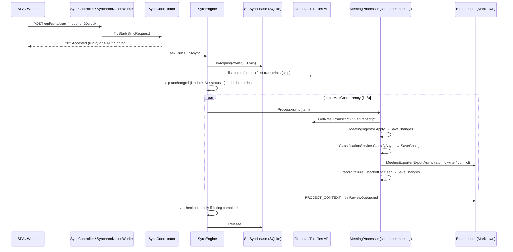
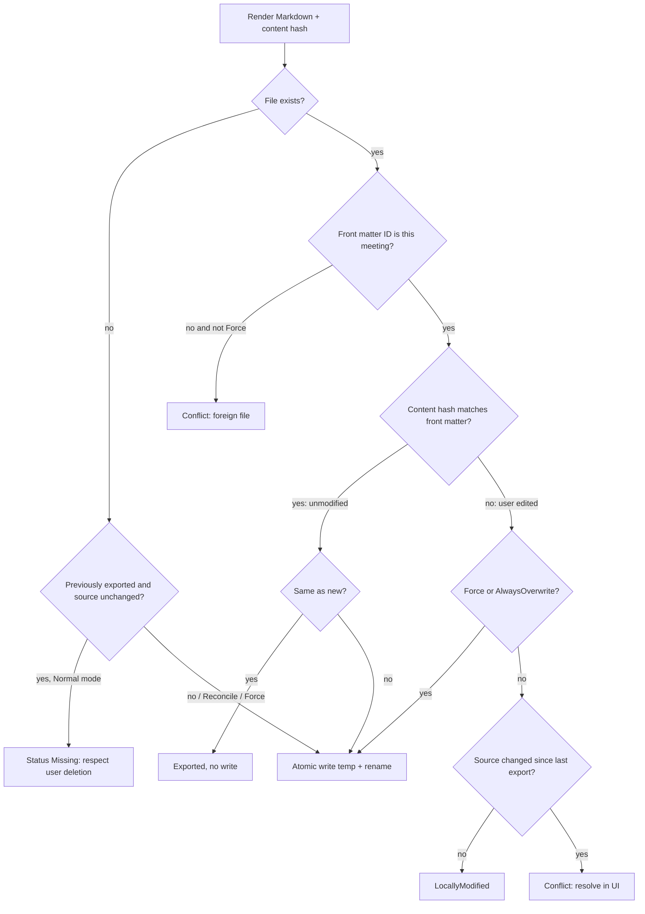
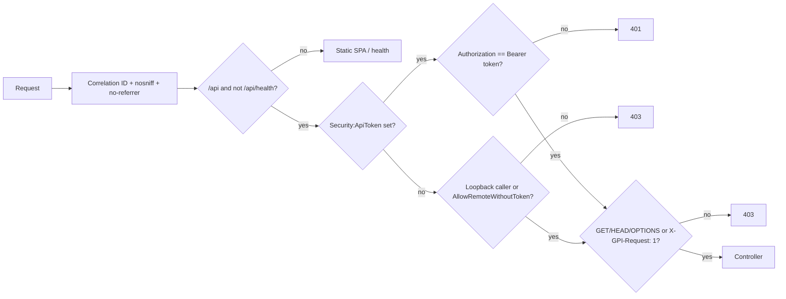

# Architecture

Last reviewed: 2026-10-28

- Evidence scope: composition roots (`Program.cs`, both `DependencyInjection.cs`), every controller, the sync pipeline (`SyncCoordinator`, `SyncEngine`, `MeetingProcessor`, `MeetingExporter`), the external clients, persistence and middleware. The authoritative human-written description is [docs/ARCHITECTURE.md](../ARCHITECTURE.md); this page verifies it against code and adds flows, trust boundaries and risks.
- Confidence: High

## Current state

**Verified:** a single-process modular monolith. One ASP.NET Core 10 process (`src/GranolaPI.Api/Program.cs`) hosts the REST API, the scheduled `SynchronizationWorker` and the built React SPA (`UseStaticFiles` + `MapFallbackToFile("index.html")`, `Program.cs:67-73`). State lives in one SQLite file (`data/granola-pi.db`, `Program.cs:19`); the product output is a folder of Markdown files under configurable export roots. EF Core migrations are applied automatically at start-up (`Program.cs:51`).

Layering (Verified by `ProjectReference`s): `Domain` ← `Application` ← `Infrastructure`, `Worker` ← `Api`. Application defines ports (`IAppDbContext`, `IGranolaApiClient`, `IFirefliesApiClient`, `IAiClassifier`, `ISecretProvider`, `ICredentialStore`, `ISettingsService`, `ISyncLease`, `IShellLauncher`, `IClock`); Infrastructure implements them.

## Components

| Component | Responsibility | Depends on | Entry point / evidence |
|---|---|---|---|
| API host | Composition root, middleware, controllers, SPA hosting, start-up migration | Application, Infrastructure, Worker | `src/GranolaPI.Api/Program.cs` |
| `RequestProtectionMiddleware` | Correlation ID, security headers, `no-store` on `/api`, loopback-only / bearer token, CSRF header | `IConfiguration` | `src/GranolaPI.Api/Middleware/Middleware.cs:60-112` |
| `ApiExceptionHandler` | Maps exceptions to RFC 7807 problem details with category + correlation ID | — | `src/GranolaPI.Api/Middleware/Middleware.cs:14-50` |
| `SyncCoordinator` (singleton) | Starts a run on a background task, one at a time per process, supports cancel | `SyncEngine`, `SyncProgress` | `src/GranolaPI.Application/Synchronization/SyncCoordinator.cs` |
| `SyncEngine` (singleton) | Orchestrates a run: lease, discovery (Granola cursor paging, Fireflies skip paging), parallel processing (1–8), run items, project context, checkpoints | `ISyncLease`, scoped services | `src/GranolaPI.Application/Synchronization/SyncEngine.cs` |
| `MeetingProcessor` (scoped per meeting) | fetch → persist → classify → export → record failure/backoff | API clients, `ClassificationService`, `MeetingExporter` | `src/GranolaPI.Application/Synchronization/MeetingProcessor.cs` |
| `ClassificationService` / `ClassificationEngine` | Deterministic tiered rule matching; optional AI tier; manual override | `IAiClassifier` | `src/GranolaPI.Application/Classification/` |
| `MeetingExporter` | Writes notes/transcript Markdown atomically, stable file names, edit/conflict detection, moves on reassignment | `ExportLayout`, `AtomicFile`, `MarkdownRenderer` | `src/GranolaPI.Application/Export/MeetingExporter.cs` |
| `ProjectContextService` | Generates `PROJECT_CONTEXT.md`, project `README.md` (once) and `ReviewQueue.md` | export layout | `src/GranolaPI.Application/Export/ProjectContextService.cs` |
| `ExportBrowserService` | Read-only tree/file browsing under roots, open in OS shell, path validation, folder picker, root migration | `IShellLauncher` | `src/GranolaPI.Application/Export/ExportBrowserService.cs` |
| `SynchronizationWorker` | Every 30 s: if auto-sync enabled, a Granola key exists and the interval has elapsed, start an incremental run; marks interrupted runs at start-up | `SyncCoordinator` | `src/GranolaPI.Worker/SynchronizationWorker.cs` |
| `GranolaApiClient` | Granola public REST API client with throttle, retry, backoff | `HttpClient`, `ISecretProvider` | `src/GranolaPI.Infrastructure/Granola/GranolaApiClient.cs` |
| `FirefliesApiClient` | Fireflies GraphQL client with throttle, retry, backoff | `HttpClient`, `ISecretProvider` | `src/GranolaPI.Infrastructure/Fireflies/FirefliesApiClient.cs` |
| `AnthropicAiClassifier` | Optional Claude call with JSON-schema output limited to known project IDs | Anthropic SDK | `src/GranolaPI.Infrastructure/Ai/AnthropicAiClassifier.cs` |
| `AppDbContext` + `SettingsService` + `SqlSyncLease` | Persistence, JSON settings sections, cross-process sync lease | EF Core SQLite | `src/GranolaPI.Infrastructure/Persistence/` |
| Credential stores + `SecretProvider` | Windows Credential Manager or read-only (env vars) | advapi32, `IConfiguration` | `src/GranolaPI.Infrastructure/Security/CredentialStores.cs` |
| `FileLoggerProvider` | JSON-lines daily log files with secret redaction and retention | — | `src/GranolaPI.Infrastructure/Logging/FileLogger.cs` |
| React SPA | Dashboard, meetings, projects/clients, unassigned review, sync history, export browser, settings | `/api` | `frontend/src/App.tsx` |

## Key flows

### 1. Manual or scheduled synchronisation (core flow)

Evidence: `SystemControllers.cs:35-40`, `SyncCoordinator.cs:20-50`, `SyncEngine.cs:33-260`, `MeetingProcessor.cs:35-157`, `SynchronizationWorker.cs:58-78`. Authentication/permission errors abort the whole run (`SyncEngine.cs:156-177`); other per-meeting errors are recorded and retried with backoff 5·2^(n−1) minutes, capped at 12 h (`MeetingProcessor.cs:171-182`).

### 2. Export write with edit protection

Evidence: `MeetingExporter.cs:258-328`, `MarkdownRenderer.cs:177-211`, `AtomicFile.cs:21-48`.

### 3. Request protection

Evidence: `Middleware.cs:64-105`; `AllowedHosts` `localhost;127.0.0.1` (`appsettings.json`), CORS origins `Security:AllowedOrigins` (`Program.cs:40-44`).

### 4. Manual assignment and reassignment

`POST /api/meetings/{id}/assign-project` → `MeetingService.AssignAsync` stores `ManualAssignment`/`ManualProjectId`, re-classifies (manual always wins, automatic disagreements recorded as conflicts, `ClassificationEngine.cs:31-82`) and re-exports; unmodified primary files are moved to the new location instead of duplicated (`MeetingExporter.cs:195-214`).

## Data and trust boundaries

| Boundary | What crosses it | Controls |
|---|---|---|
| Browser ↔ API (loopback) | All meeting data, settings, masked keys | Loopback-only default, `AllowedHosts`, CSRF header, CORS allow-list, `Cache-Control: no-store` |
| Remote caller ↔ API (server mode) | Same | Bearer `Security:ApiToken` (constant-time compare); TLS must be provided by a reverse proxy (`docker-compose.yml` comments) |
| API ↔ Granola / Fireflies | API keys (outbound only), meeting content (inbound) | HTTPS, bearer keys from `ISecretProvider`, IDs validated before use in URLs (`GranolaApiClient.cs:291-295`, `FirefliesApiClient.cs:228-232`) |
| API ↔ Anthropic (opt-in) | Title, participant names/emails, speakers, folders, optional summary, project list | Off by default; prompt treats meeting data as untrusted; output constrained to known project IDs (`AnthropicAiClassifier.cs`) |
| API ↔ file system | Generated Markdown; reads of `.md` for browsing | `SafePath.Combine/IsUnder` root guards, template validation, reparse points skipped, atomic writes, never deletes user files |
| API ↔ OS secret store | API keys | Windows Credential Manager (per user) or env vars; never in DB or settings JSON |

## Architectural constraints

- Single writer per database: the sync lease (`SqlSyncLease`) protects against two processes syncing at once; SQLite is the only configured provider (`src/GranolaPI.Infrastructure/DependencyInjection.cs:26`), although the schema avoids SQLite-only features (`AppDbContext.cs:9-12`).
- Desktop features (Credential Manager writes, open in Explorer, folder picker usefulness) only work when the process runs on the user's machine (`Dockerfile` comment, `ShellLauncher.IsSupported`).
- No user accounts or roles: one user per installation (Verified: no authentication/authorization framework registered in `Program.cs`).

## Architectural risks

| Item | Evidence | Impact | Suggested action |
|---|---|---|---|
| Source-specific naming in a now multi-source model (`GranolaNoteId`, `GranolaApiException`, `GranolaNoteFetch` reused for Fireflies) | `Entities.cs:64`, `FirefliesModels.cs:116`, `MeetingProcessor.cs:58-60` | Confusing for contributors; unique index ignores `Source` (RF-006) | TD-003 |
| Committed compiler output shadows frontend sources | `frontend/src/**/*.js`, Vite resolution order | UI edits silently ignored; stale bundle shipped | RF-001, PIDA-001 |
| Duplicate singleton registration of `LogSettingsState` | `Program.cs:22`, `src/GranolaPI.Infrastructure/DependencyInjection.cs:51` | Logging settings saved in the UI do not reach the logger until restart | RF-003, PIDA-003 |
| Legacy Node CLI duplicates the Granola client and matching logic | `tools/node-cli/src/` | Divergent behaviour if anyone still uses it | TD-002, Q-003 |

## Architecture decisions

Pre-existing choices are recorded in [project-management/DECISIONS.md](../../project-management/DECISIONS.md) (ADR-001 – ADR-007). No `docs/adr/` folder exists.
