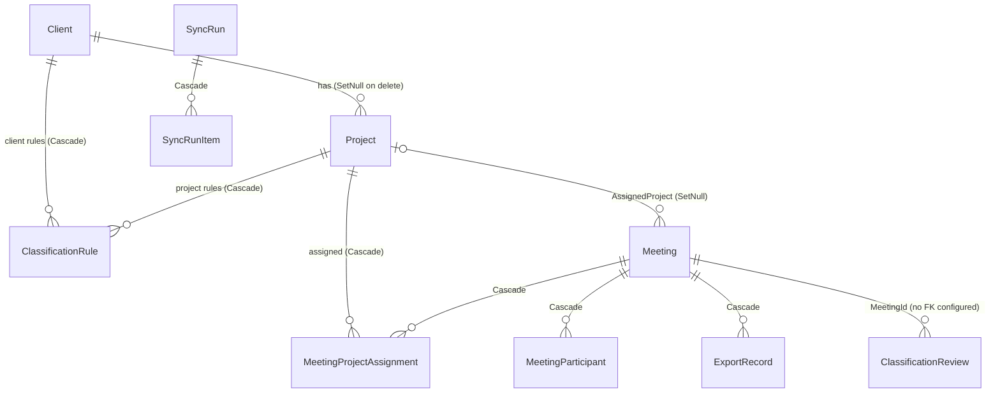

# Data Model

Last reviewed: 2026-10-28

- Evidence scope: `src/Chroniq.Domain/Entities/Entities.cs`, `src/Chroniq.Domain/Enums/Enums.cs`, `src/Chroniq.Infrastructure/Persistence/AppDbContext.cs`, `SettingsService.cs`, migrations `20261026152901_InitialCreate` (12 `CreateTable` calls) and `20261027144432_AddMeetingSource`, `src/Chroniq.Application/Interfaces/Interfaces.cs` (`SettingKeys`, `SecretNames`). The live database was not opened (it holds meeting content).
- Confidence: High

## Data stores

| Store | Purpose | Evidence | Environment notes |
|---|---|---|---|
| SQLite `chroniq.db` | Operational state: meetings (incl. full notes/summary/transcript JSON), projects, clients, rules, export records, sync history, settings, sync lease | `Program.cs:17-19`, `src/Chroniq.Infrastructure/DependencyInjection.cs:26` | Desktop: `<repo or BaseDirectory>/data/chroniq.db`. Docker: `/data/state` volume (`App__DataDirectory`). Overridable with `ConnectionStrings:Default`. |
| Export roots (Markdown files) | The product output: notes, transcripts, `PROJECT_CONTEXT.md`, project `README.md`, `ReviewQueue.md` | `ExportLayout.cs`, `ProjectContextService.cs` | Default `./ChroniqKnowledge` relative to `App:BaseDirectory` (`AppSettings.cs:11`); separate notes/transcripts roots optional. Docker: bind mount `./ChroniqKnowledge`. |
| Log files | JSON lines, one file per UTC day, `chroniq-yyyyMMdd.log` | `FileLogger.cs:46-55` | `data/logs` by default; retention 14 days (`AppSettings.cs:89-91`) |
| OS secret store / environment | API keys (Granola, Fireflies, Anthropic) | `CredentialStores.cs` | Never stored in SQLite (`AppDbContext.cs:9-10`). See [security-review.md](security-review.md). |

## Entity relationships

`ExportRecord.ProjectId`, `SyncRunItem.MeetingId` and `Meeting.ManualProjectId` are plain columns without a configured foreign key (Verified: no `HasOne` for them in `AppDbContext.cs`).

## Entities / tables

| Entity | Key | Relationships / indexes | Sensitive fields | Tenant/ownership rule | Evidence |
|---|---|---|---|---|---|
| `Client` | `Id` (Guid, code-generated) | Unique `Name`; projects, rules | Customer names (business data) | Single user; none | `Entities.cs:5-15`, `AppDbContext.cs:47-51` |
| `Project` | `Id` | Unique `Slug` (≤64), index `Status`; optional `ClientId`; folder overrides `NotesFolderPath`/`TranscriptFolderPath` (≤400) | — | none | `Entities.cs:17-38`, `AppDbContext.cs:53-62` |
| `ClassificationRule` | `Id` | Owned by exactly one of project or client (check constraint `CK_Rule_Owner`); index (`Kind`, `NormalizedValue`) | Participant emails/names as rule values | none | `Entities.cs:45-57`, `AppDbContext.cs:64-72` |
| `Meeting` | `Id`; **unique `GranolaNoteId`** (≤64, holds the Granola note ID or the Fireflies transcript ID) | `Source` (Granola/Fireflies, added by `AddMeetingSource`); indexes on start time, created, classification status, export status, assigned project, (`ExportPending`, `NextRetryAt`) | **High:** `Summary`, `NotesContent`, `TranscriptContent` (full meeting text), `AttendeesJson`, `ParticipantEmailsJson`, `OwnerEmail`, `CalendarEventJson` | none | `Entities.cs:59-126`, `AppDbContext.cs:74-89` |
| `MeetingParticipant` | `Id` | `MeetingId` FK; index `Email` | Names, emails | none | `Entities.cs:128-139` |
| `MeetingProjectAssignment` | `Id` | Unique (`MeetingId`, `ProjectId`) | — | none | `Entities.cs:141-150` |
| `ExportRecord` | `Id` | One per generated file; index (`MeetingId`, `Kind`, `Location`, `ProjectId`), `RelativePath`, `Status`, `ProjectId` | Relative file paths (contain meeting titles) | none | `Entities.cs:152-171` |
| `SyncRun` / `SyncRunItem` | `Id` | Run → items (Cascade); indexes `StartedAt`, `Status`, `MeetingId` | Error messages (≤1000) | none | `Entities.cs:173-209` |
| `ApplicationSetting` | `Key` (≤100) | JSON value per section | No secrets (Verified: keys are `export`, `sync`, `classification`, `logging`, `sync.checkpoint`, `sync.checkpoint.fireflies`, `granola.connection`, `fireflies.connection`) | none | `Interfaces.cs:36-43`, `SettingsService.cs` |
| `ClassificationReview` | `Id` | index `MeetingId` | Free-text `Note` | none | `Entities.cs:218-226` |
| `SyncLease` | `Id` = `"sync"` | Single row; compare-and-set via `ExecuteUpdateAsync` | — | — | `Entities.cs:229-234`, `SettingsService.cs:56-102` |

Conventions (Verified, `AppDbContext.cs:28-45`): all enums stored as strings (max 40); all `DateTime` values stored and read as UTC; Guid IDs generated in code (`ValueGenerated.Never`).

## Migrations and data lifecycle

- **Migration mechanism:** EF Core migrations in `src/Chroniq.Infrastructure/Persistence/Migrations/`, applied automatically with `db.Database.MigrateAsync()` at every start-up (`Program.cs:48-51`). Tool: `dotnet-ef` 10.0.5 (`dotnet-tools.json`). Latest migration: `20261027144432_AddMeetingSource` (adds `Meetings.Source`, default `Granola`).
- **Backfill / rollback:** `AddMeetingSource.Down` drops the column. No documented rollback procedure; the safe rollback is restoring a copy of `chroniq.db` (see [docs/TROUBLESHOOTING.md](../TROUBLESHOOTING.md#backup-and-recovery)). Because migrations run automatically, starting an older build against a newer database is Unknown/unsupported (Q-006).
- **Retention / deletion:** sync runs, meetings and export records are never purged by code (Inferred, Medium: no delete paths found apart from `DeleteClientAsync`, `ProjectService.cs:275`). Deleted/inaccessible source meetings are marked `SourceStatus.Deleted/Inaccessible` and their files are kept (`SyncEngine.cs:348-354`, `MeetingProcessor.cs:74-83`). Log files are pruned by age (`FileLogger.cs:50-55`). See Q-010.
- **Indexes / constraints:** listed above. Gap: uniqueness of `Meeting.GranolaNoteId` does not include `Source` (RF-006).
- **Settings:** stored as JSON per section; unknown or corrupt JSON falls back to defaults (`SettingsService.cs:24-36`), so new settings are backward compatible.
- **Verified source paths:** `src/Chroniq.Infrastructure/Persistence/AppDbContext.cs`, `src/Chroniq.Domain/Entities/Entities.cs`, `src/Chroniq.Infrastructure/Persistence/Migrations/`.
