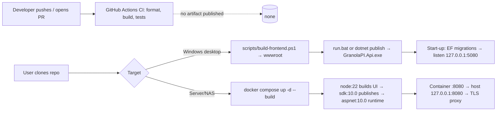

# Deployment

Last reviewed: 2026-10-28

- Evidence scope: `Dockerfile`, `docker-compose.yml`, `run.bat`, `stop.bat`, `scripts/build-frontend.ps1`, `.github/workflows/ci.yml`, `Program.cs`, `appsettings*.json`, [docs/INSTALLATION.md](../INSTALLATION.md), `README.md` "Production". Nothing outside the repository (registries, servers, schedulers) was visible.
- Confidence: Medium (no deployed environment could be observed)

## Deployment strategy

This is a **self-hosted, single-user app with no central deployment**. Each user builds and runs their own copy. There are two documented ways:

1. **Windows desktop (primary):** build the UI into the API's `wwwroot`, then either double-click `run.bat` (build + run from source) or `dotnet publish` and run `GranolaPI.Api.exe`, optionally from Task Scheduler at log-on. It listens on `127.0.0.1:5080` only.
2. **Server / NAS:** `docker compose up -d` builds a multi-stage image locally and runs it with keys and an API token from a `.env` file, bound to `127.0.0.1:8080` behind a user-provided TLS reverse proxy.

There is no CD pipeline, no published image or package, no versioning and no release tags (Verified: `git tag` is empty; CI has no publish step).

## Deployment flow

## What is deployed

| Sub-project | Artifact | Registry / store | Versioning / tagging | Target | Evidence |
| --- | --- | --- | --- | --- | --- |
| API host (+ Worker, Application, Infrastructure, Domain) | `dotnet publish` output (`GranolaPI.Api.exe` / `.dll`) | None | None (assembly version default; `/api/health` reports it) | User's Windows machine | `README.md:91-94`, `SystemControllers.cs:25` |
| Frontend | Vite `dist/` copied to `wwwroot/` | None | None | Served by the API | `scripts/build-frontend.ps1`, `Dockerfile:18` |
| Container | Local image built by compose (`build: .`) | None | None | User's server/NAS | `docker-compose.yml` |
| `tools/node-cli` | Not deployed | — | — | — | `README.md:43` |

## Environments

| Environment | Purpose | How deployed | Config source | Required variable names | Evidence |
| --- | --- | --- | --- | --- | --- |
| Development | Local coding | `dotnet run` with `ASPNETCORE_ENVIRONMENT=Development`; Vite dev server | `appsettings.Development.json` (`App:BaseDirectory=../..`), `launchSettings.json` | none required | files |
| Testing | Integration tests | `WebApplicationFactory` with environment `Testing`, worker off, in-memory credentials | `TestHost.cs:197-201` | none | file |
| Production (desktop) | Personal use | `run.bat` (sets `ASPNETCORE_ENVIRONMENT=Production`, `App__BaseDirectory`) or published exe | `appsettings.json`, settings in SQLite, Windows Credential Manager | optional `GRANOLA_API_KEY`, `FIREFLIES_API_KEY`, `ANTHROPIC_API_KEY` | `run.bat`, `appsettings.json` |
| Production (container) | Server/NAS | `docker compose up -d` | env vars from `.env` | `GRANOLA_API_KEY` (required by compose), `GPI_API_TOKEN` → `Security__ApiToken` (required), `FIREFLIES_API_KEY`, `ANTHROPIC_API_KEY` (optional); image sets `ASPNETCORE_URLS`, `App__BaseDirectory=/data`, `App__DataDirectory=/data/state`, `Security__UseWindowsCredentialManager=false` | `docker-compose.yml`, `Dockerfile` |

## Pipelines

| Pipeline | Trigger | Stages | Deploys to | Evidence |
| --- | --- | --- | --- | --- |
| `.github/workflows/ci.yml` | push to `main` (repo uses `master`, RF-002), pull requests | restore → format → build → test (backend); `npm ci` → build → test (frontend) | Nothing | `ci.yml` |

## Infrastructure

Not applicable — no infrastructure as code (Verified: no Terraform, Bicep, Kubernetes, Helm or cloud config files). The container needs one volume for state (`granola-pi-state:/data/state`) and one bind mount for the Markdown repository (`./GranolaProjectKnowledge:/data/GranolaProjectKnowledge`).

## Configuration and secrets

- Configuration keys (names only): `Urls`, `AllowedHosts`, `App:BaseDirectory`, `App:DataDirectory`, `ConnectionStrings:Default`, `Worker:Enabled`, `Security:UseWindowsCredentialManager`, `Security:AllowedOrigins`, `Security:AllowRemoteWithoutToken`, `Security:ApiToken`, `Secrets:GranolaApiKey`, `Secrets:FirefliesApiKey`, `Secrets:AiApiKey`, `Logging:LogLevel:*`. Full reference: [docs/CONFIGURATION.md](../CONFIGURATION.md).
- Runtime settings (export, sync, classification, logging) live in the SQLite `ApplicationSettings` table and are edited in the UI.
- Secrets: Windows Credential Manager (desktop) or environment variables / `.env` (server). `.env` and `.env.*` are git-ignored (`.gitignore:24-26`).

## Database migrations

Applied automatically at every start-up (`Program.cs:48-51`). There is no separate migration step, no pre-deploy backup and no down-migration procedure. Back up `data/granola-pi.db` (or the `/data/state` volume) before upgrading.

## Release process

- Versioning and tags: none (Verified: no tags, no version property in `Directory.Build.props`).
- Changelog / release notes: none (no `CHANGELOG*`).
- Feature flags and default states: `Worker:Enabled` (default true); settings `sync.autoSyncEnabled` (off by default per README), `classification.ai.enabled` (off by default, `docs/SECURITY.md`).
- Approvals: Unknown (branch protection not visible, Q-001).

## Rollback

Desktop: check out the previous commit, rebuild, restore the backed-up `granola-pi.db` if a migration ran. Container: rebuild from the previous commit; restore the state volume. Because migrations run automatically and nothing is versioned, rollback is manual and requires a database backup (Inferred, High). Exported Markdown files are never deleted by the app, so they survive a rollback.

## Post-deploy verification

- `GET /api/health` returns status, version, DB connectivity, whether a key is configured and whether a sync is running (`SystemControllers.cs:20-28`); `run.bat` polls it before opening the browser.
- Settings → Connections → "Test connection" for each source.
- Optional: `npm run e2e` (read-only browser smoke) against the running app.

## Observability in deployed environments

JSON-lines log files in `data/logs` (or `/data/state/logs`), one per UTC day, secrets redacted, retention 14 days; correlation ID in every API response (`X-Correlation-ID`) and problem details. No metrics, tracing export or alerting (Verified: no OpenTelemetry or APM packages). Sync history is visible in the UI (`/sync-history`).

## Manual steps and unknowns

- Building the frontend before `dotnet publish` (desktop) is manual (`README.md:93`).
- Scheduling the desktop exe at log-on (Task Scheduler) is manual.
- TLS reverse proxy for server mode is user-provided.
- Whether anyone runs the container mode in practice is Unknown (Q-005).

## Recommended improvements

| Improvement | Why | Effort | Priority | Task |
| --- | --- | --- | --- | --- |
| Run CI on the real default branch | Pushes to `master` are unchecked | S | P1 | PIDA-002 |
| Remove committed tsc output so builds use the sources | Stale UI could ship | S | P0 | PIDA-001 |
| Add a version (e.g. `<Version>` in `Directory.Build.props`) and tag releases | Health endpoint and bug reports can identify builds | S | P3 | PIDA-018 |
| Back up the database automatically before applying migrations | Safe upgrades/rollback | M | P3 | PIDA-018 |
