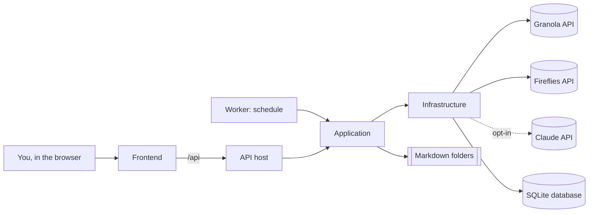

# CHRONIQ

Last reviewed: 2026-10-28

- Evidence scope: the whole repository's code, tests and docs (user data folders excluded). Technical detail is in [project-overview.md](project-overview.md).
- Confidence: High

This page explains the project in plain language for anyone joining it: developers, testers, product owners, and stakeholders. Technical details live in `project-overview.md` and the pages it links to.

## What it is

It is a small app that runs on your own computer (or your own server). It copies your meeting notes and transcripts from **Granola** and, optionally, from **Fireflies.ai**. It works out which of your projects each meeting belongs to and saves everything as ordinary Markdown text files in folders you choose. The result is a tidy, searchable folder of meeting knowledge per project that still works when the app is closed. You can open it in an editor, keep it in Git, or hand it to an AI coding assistant. (Verified: `README.md:1-5`; code in `src/`.)

## The problem it solves

Meeting tools keep notes inside their own apps, mixed together and hard to reuse. People who work on several projects or for several customers have to copy notes out by hand and file them, or lose track of what was agreed. This app automates the copying and the filing. It is careful never to lose or overwrite anything the user has written. (Inferred, High: from the README and the many data-safety features in the code.)

## Who uses it

| User / role | What they want to achieve | Main workflows | Evidence |
| --- | --- | --- | --- |
| The installing user: consultant, developer or team lead with many meetings | Keep an organised, private record of every meeting per project | Connect Granola/Fireflies → set up projects and rules → sync → review unassigned meetings → read or edit files (FEAT-001, 002, 010, 008, 006) | `README.md` quick start, routes in `frontend/src/App.tsx` |
| The same user's AI coding assistant | Read project context from Markdown files | Opens `Projects/<name>/` and `PROJECT_CONTEXT.md` (FEAT-012) | `README.md:5` |

There is one user per installation. There are no logins or roles (Verified).

## What it does

- Imports every Granola meeting your key can see, then keeps up with changes — FEAT-001 — Implemented
- Imports Fireflies.ai calls in the same way — FEAT-002 — Implemented
- Syncs automatically on a schedule — FEAT-003 — Partial (not for Fireflies-only users; untested)
- Sorts meetings into projects using rules you set, and explains why — FEAT-004 — Implemented
- Optionally asks Claude (AI) to suggest a project when no rule fits — FEAT-005 — Partial (untested)
- Writes notes and transcripts as separate Markdown files in folders you design — FEAT-006 — Implemented
- Protects your own edits: never silently overwrites a file you changed — FEAT-007 — Implemented
- Lists meetings it could not place, so you can file them and teach it new rules — FEAT-008 — Implemented
- Lets you move a meeting to another project, to "Shared", or exclude it — FEAT-009 — Implemented
- Manages projects, customers and rules, with a dry run before applying — FEAT-010, FEAT-011 — Implemented
- Creates a summary page per project and a review list — FEAT-012 — Implemented
- Lets you browse and open the files from the app — FEAT-013 — Implemented
- Moves the whole export folder somewhere else safely — FEAT-014 — Partial (untested)
- Stores API keys safely and never shows them in full — FEAT-015 — Implemented
- Settings, dashboard, meeting list, sync history and controls — FEAT-016 to FEAT-019 — Implemented
- Blocks other computers and other websites from using it — FEAT-020 — Implemented
- Keeps logs without secrets — FEAT-021 — Partial (log settings apply only after restart)
- An older command-line version is kept for reference — FEAT-022 — Deprecated

Full list with evidence: [feature-inventory.md](feature-inventory.md).

## How people use it

**First run.** Start the app (`run.bat`), and the browser opens at `http://127.0.0.1:5080`. In Settings, paste your Granola API key, which the app checks. Choose where files should go. Create a few projects with rules, for example "anyone from @acme.com → Acme Portal". Click **Sync now**. The app imports your history and files each meeting. Meetings it is unsure about land in **Unassigned**. There you pick the right project, or save a rule from the meeting and apply it to similar ones.

**Every day.** Turn on automatic sync, or click Sync now after meetings. New and changed meetings appear in the right project folders. If you edited a file and the meeting later changed in Granola, the app marks a *conflict* and asks whether to keep your version, take the new one, or save both.

## How it is organized

| Sub-project | What it is | Type | Location | Page |
| --- | --- | --- | --- | --- |
| API host | The running app: web API, security, hosts the UI and the scheduler | API | `src/Chroniq.Api/` | [projects/api](projects/api/project.md) |
| Worker | The scheduler that starts automatic syncs | Worker | `src/Chroniq.Worker/` | [projects/worker](projects/worker/project.md) |
| Application | The business logic: syncing, sorting, writing files | Library | `src/Chroniq.Application/` | [projects/application](projects/application/project.md) |
| Infrastructure | Connections to Granola, Fireflies, Claude, the database, the key store and log files | Library | `src/Chroniq.Infrastructure/` | [projects/infrastructure](projects/infrastructure/project.md) |
| Domain | The basic data types | Library | `src/Chroniq.Domain/` | [projects/domain](projects/domain/project.md) |
| Frontend | The screens you use in the browser | Web app | `frontend/` | [projects/frontend](projects/frontend/project.md) |
| Node CLI | The earlier script version, kept for reference | CLI (deprecated) | `tools/node-cli/` | [projects/node-cli](projects/node-cli/project.md) |

## Clients

Not applicable: each installation serves one person. The app's own "Clients" screen is for *your* customers, used to group projects. It is not a way to serve different companies (see [client-matrix.md](client-matrix.md)).

## Current state

The project is new and works: three commits over two days (27–28 October 2026), with good automated test coverage of the main flows. It has no formal releases. The most important issues found:

- A build problem means the browser UI may be built from stale copies of its code (R-001).
- Automatic checks do not run on the main branch (R-002).
- Automatic sync does not work for people who use only Fireflies (RF-004).
- Some secondary features (AI suggestions, moving the export folder, server-mode login) have no tests.

See [project-management/RISKS.md](../../project-management/RISKS.md).

## Where to go next

- Technical summary, stack, and how to run it: [project-overview.md](project-overview.md)
- Where the code lives: [repository-map.md](repository-map.md)
- Every feature and its status: [feature-inventory.md](feature-inventory.md)
- Open questions: [open-questions.md](open-questions.md)
